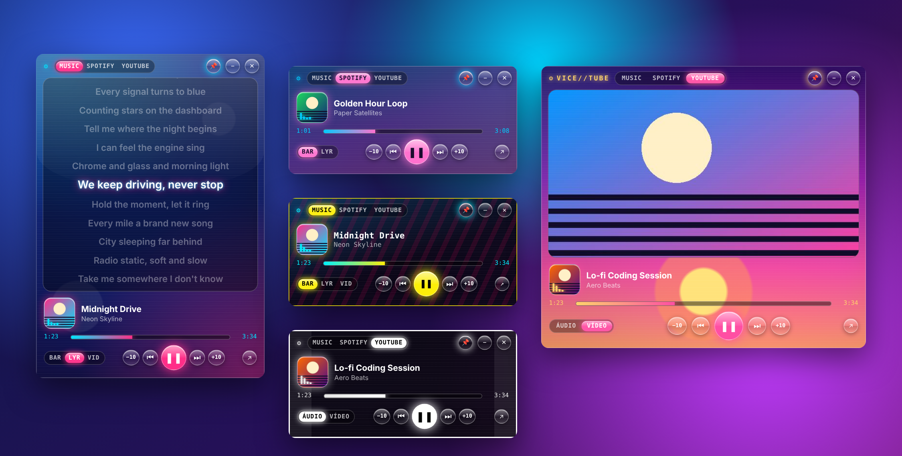
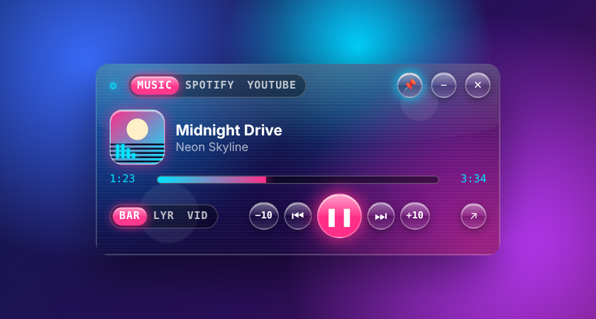
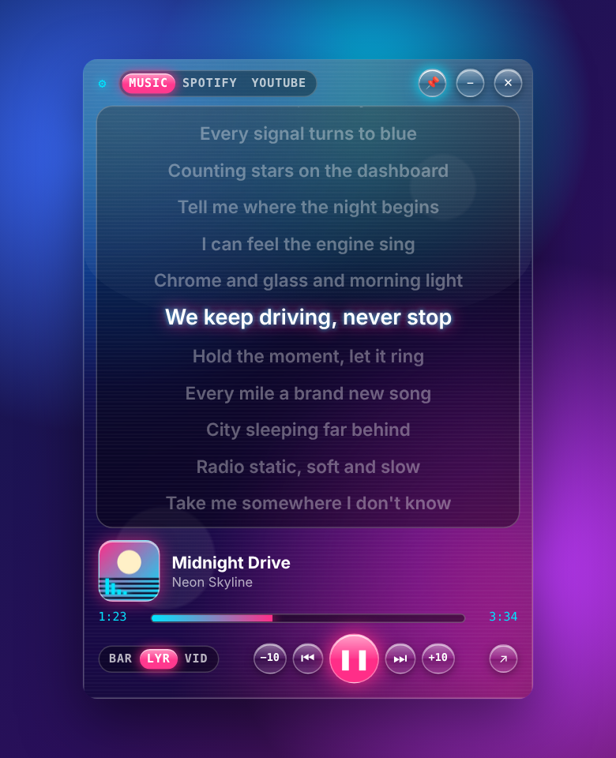
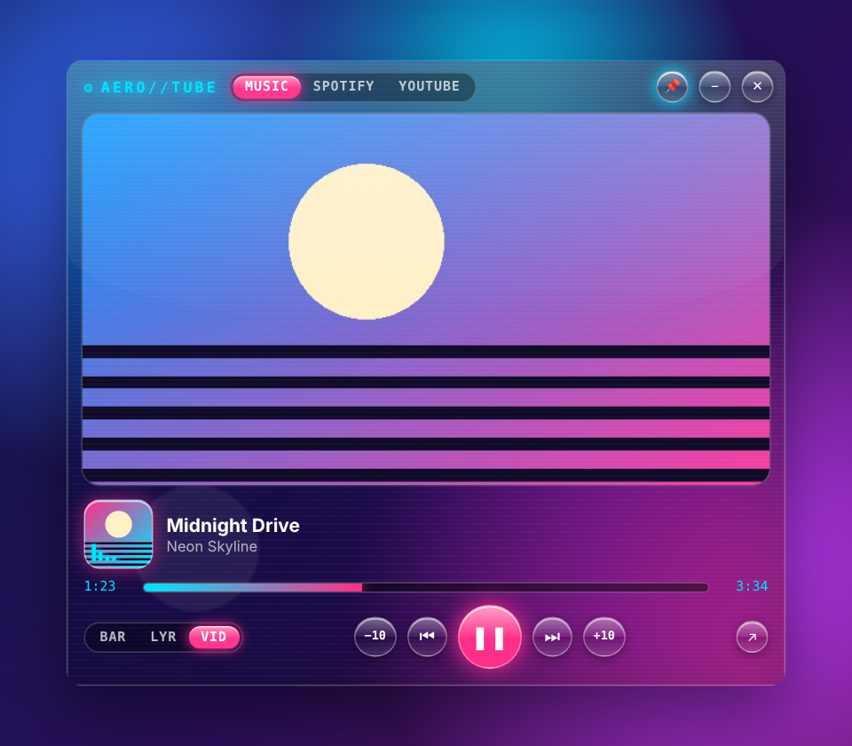
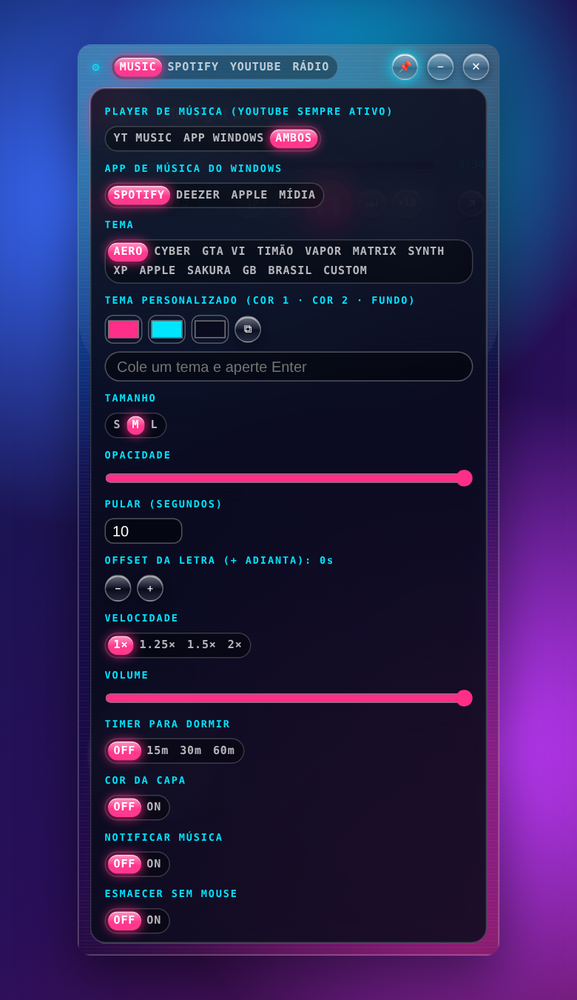
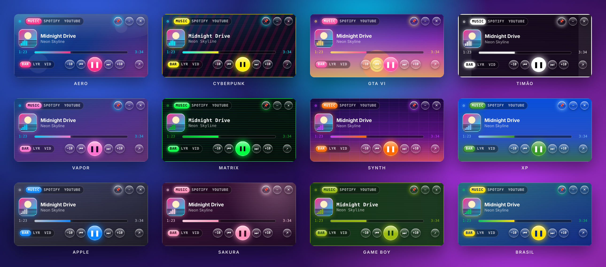
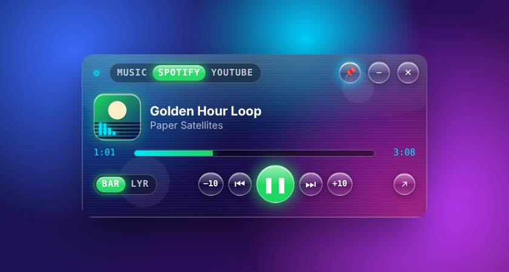

<div align="center">

# AeroTube

**Widget de controle para YouTube Music, YouTube e Spotify no Windows.**
Visual Frutiger Aero, cyberpunk e mais 10 temas.

[](https://github.com/nicolassilv04/aero-tube/releases/latest/download/AeroTube-win.zip)




</div>

<!-- As imagens em docs/img foram geradas a partir da interface real, com dados de exemplo. Para trocar por capturas reais, use Win+Shift+S e salve com o mesmo nome. -->

## Sumário

[Recursos](#recursos) · [Instalação](#instalação) · [Modos](#modos) · [Temas](#temas) · [Spotify](#spotify) · [Atalhos](#atalhos-globais) · [Rodar pelo código](#rodar-pelo-código) · [Perguntas frequentes](#perguntas-frequentes) · [Licença](#licença)

## Recursos

- **YouTube Music, YouTube e Spotify** no mesmo widget. Escolha qual player de música usar, ou use os dois. O YouTube fica sempre ativo.
- **Modos para cada gosto:** só a barra de reprodução, letra sincronizada, vídeo, ou só áudio.
- **Tamanhos S, M e L**, além de redimensionamento livre arrastando as bordas.
- **12 temas** e opção de usar a cor da capa como destaque.
- **Pular segundos:** você define quantos, de 1 a 600.
- **Velocidade, volume, repetir faixa e timer para dormir.**
- **Extras:** notificação ao trocar de música, esmaecer quando o mouse sai, iniciar com o Windows e janela sempre no topo.
- **Atalhos globais** que funcionam com qualquer app em foco.
- **Abrir no navegador** no ponto exato em que você está.
- **Salva tudo:** tema, posição, opacidade e preferências.

## Instalação

1. Baixe o **[AeroTube-win.zip](https://github.com/nicolassilv04/aero-tube/releases/latest/download/AeroTube-win.zip)** (ou abra a aba [Releases](https://github.com/nicolassilv04/aero-tube/releases)).
2. Extraia para uma pasta fixa, como `C:\AeroTube`.
3. Abra o **AeroTube.exe**.
4. Se o Windows mostrar "protegeu seu PC", clique em **Mais informações > Executar assim mesmo**. O app não tem assinatura digital paga, então esse aviso é esperado.
5. Para fixar na barra de tarefas, clique com o botão direito no ícone com o app aberto.

Não precisa instalar Node, Git ou qualquer outra coisa. Guia completo: [DOCUMENTACAO.md](DOCUMENTACAO.md).

## Modos

<table>
  <tr>
    <td align="center"><b>Barra</b><br></td>
    <td align="center"><b>Letra sincronizada</b><br></td>
  </tr>
  <tr>
    <td align="center"><b>Vídeo</b><br></td>
    <td align="center"><b>Configurações (⚙)</b><br></td>
  </tr>
</table>

| Player | Modos | Observações |
|---|---|---|
| YouTube Music | `BAR`, `LYR`, `VID` | Abra o `VID` para buscar músicas e fazer login |
| YouTube | `ÁUDIO`, `VÍDEO` | O áudio continua tocando com o vídeo escondido |
| Spotify | `BAR`, `LYR` | Sem login, lido pelo controle de mídia do Windows |

## Temas



Aero (padrão), Cyberpunk, GTA VI, Timão, Vapor, Matrix, Synth, XP, Apple, Sakura, Game Boy e Brasil. Troque no **⚙** a qualquer momento.

## Spotify



O Spotify é controlado pelo **controle de mídia do Windows**. Por isso:

- não precisa de login, de conta de desenvolvedor nem de Premium
- funciona para qualquer pessoa que tenha o app do Spotify instalado
- você tem play/pause, anterior/próxima, barra de progresso, pular segundos e letra

Deixe o **app do Spotify para Windows** aberto e tocando. A versão do navegador não é detectada. Volume, velocidade e repetir faixa valem só para YouTube e YouTube Music.

<br clear="right">

## Atalhos globais

| Atalho | Ação |
|---|---|
| `Ctrl` + `Alt` + `Espaço` | Play / pause |
| `Ctrl` + `Alt` + `←` / `→` | Anterior / próxima |
| `Ctrl` + `Alt` + `↑` / `↓` | Pular para frente / para trás |

## Rodar pelo código

Requer **Node 22** e Windows.

```bash
git clone https://github.com/nicolassilv04/aero-tube.git
cd aero-tube
npm install
npm start
```

| Comando | O que faz |
|---|---|
| `npm start` | Abre o app em modo de desenvolvimento |
| `npm run build` | Gera o app em `dist/win-unpacked` |
| `npm run pack` | Gera o app e o zip `dist/AeroTube-win.zip` |

Para publicar uma versão, crie uma tag (`git tag v1.0.1` e `git push origin v1.0.1`). O GitHub Actions monta o zip e o anexa em Releases.

### Estrutura

```
index.html   interface (HTML, CSS e JS)
main.js      janela, atalhos globais, letras e ponte com o Spotify
preload.js   ponte segura entre a interface e o sistema
media.ps1    leitura e controle do Spotify via controle de mídia do Windows
build/       ícone do app
```

## Perguntas frequentes

**É seguro?** O código é aberto e está neste repositório. O aviso do Windows acontece só porque o app não é assinado.

**Preciso de conta no YouTube?** Não. Com login você tem playlists, histórico e recomendações. Faça o login pelo modo `VID`.

**O Google diz "navegador não seguro".** O app usa uma identificação que costuma ser aceita. Se ainda assim bloquear, ele funciona sem conta.

**A letra está errada ou adiantada.** Ajuste o **Offset da letra** no ⚙. Algumas músicas não têm letra no [lrclib.net](https://lrclib.net).

**O vidro (acrílico) não aparece.** Esse efeito é do Windows 11. No Windows 10 o fundo fica escuro e sem desfoque.

**"Spotify não detectado".** Abra o app do Spotify no Windows e dê play.

## Créditos

- [Electron](https://www.electronjs.org) para a base do app
- [lrclib.net](https://lrclib.net) para as letras sincronizadas

## Licença

[MIT](LICENSE). Projeto não oficial, sem relação com Google, YouTube ou Spotify. Os nomes e marcas pertencem aos seus donos, e os temas são homenagens de fã.
